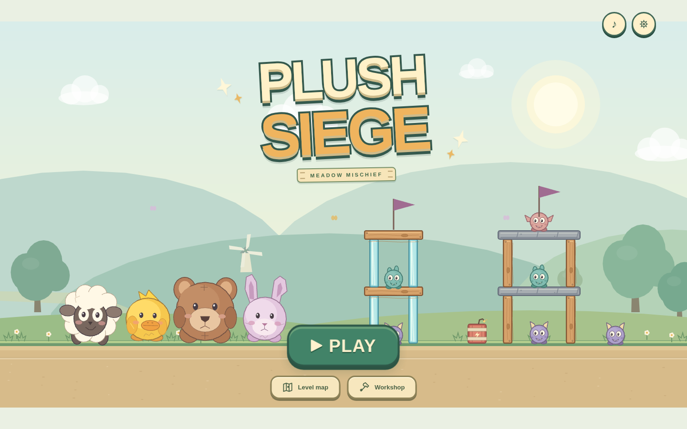
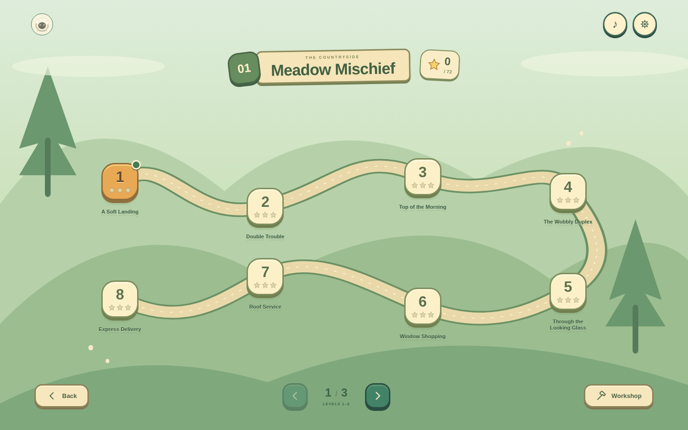
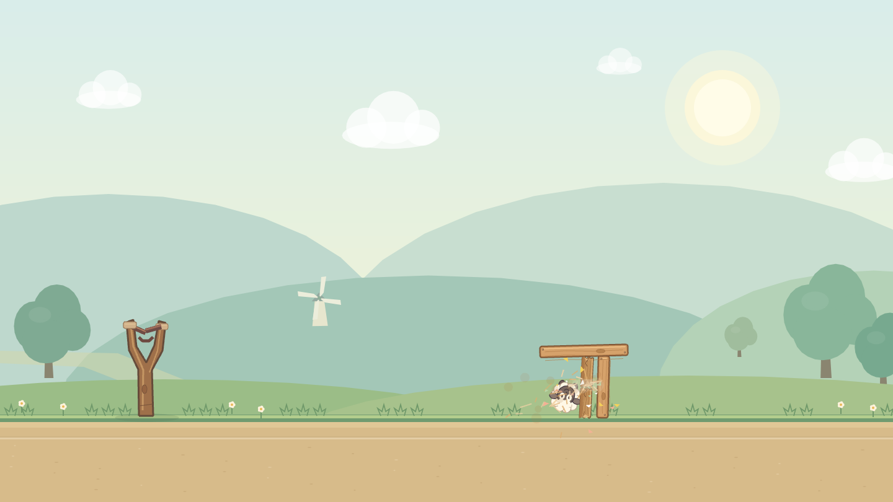
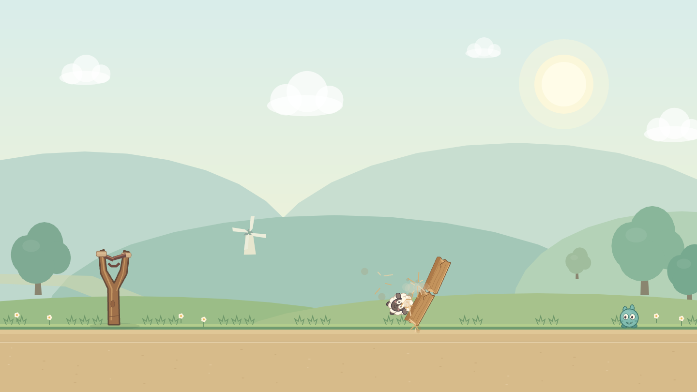

> Historical Pass 2 report. The current release is documented in [Pass 3](pass-3-report.md).

# Development Pass 2 — Physics and game feel

The 0.2.0 build keeps the same 24-level Meadow Mischief campaign and original character identity. This pass concentrates on physical destruction and reliable controls, with a game-first title and trail map as the secondary presentation change.

## Why blocks disappeared

The original collision callback multiplied total relative speed by a mass factor. It included tangential sliding, did not account properly for contact direction/rotational inertia, and routinely exceeded the small wood/glass health values on first impact. `destroy()` immediately removed the rigid body. Its replacement particles were cosmetic, so beams could not continue tumbling or damaging nearby objects.

The replacement uses **normal closing energy at the contact point**, including angular velocity and effective mass. A glancing slide no longer has the same damage as a direct blow. Material durability is tuned independently: glass fractures readily, wood cracks and moves before breaking, and stone is heavy and durable. Ordinary shots can destabilize supports without automatically deleting the entire structure.

A failed block stays physical for another 100 ms, making the impact readable, then splits into two wood/stone pieces or three glass pieces along its long axis. These pieces inherit the parent's mass, linear velocity, and rotation, collide with surrounding objects, and can defeat monsters. Fractured edges, material particles, dust, impact squash, trails, restrained camera motion, and material/ability-specific sound distinguish the reactions.

Large fragments are capped at 72. At the budget, large pieces remain cracked physical bodies; they do not vanish to meet the limit. Recursive breakage stops at two generations and a minimum piece size. Small dust/splinters/shards are cosmetic and capped at 140 particles. Quiet, sleeping, unsupported fragments become eligible for cleanup after 45 seconds; supports, including fragment-to-fragment support chains, remain physical.

## Gameplay and controls

- Mallow has a modest buoyant hop; Pip boosts along his flight direction; Bruno stomps downward with his existing heavy mass; Clover splits into three smaller rabbits while conserving total mass and linear momentum.
- Abilities require a live, airborne current projectile, a release debounce, and one short tap/click. Swipes, canceled gestures, and multi-touch do not activate them. Ability rings, trails, distinct tones, and the flight hint communicate activation.
- Matter steps at 60 Hz. Launch power and gravity remain consistent with the trajectory guide. Collision mass, material durability, angular response and settling were corrected rather than replacing Matter.
- Failure no longer truncates ongoing physics at 22 seconds. Both outcome resolution and next-shot readiness wait for the physical scene to settle. Spent stuffies remain bodies, so changing shots cannot silently remove a structural support.
- Hidden construction warm-up was removed. Stability checks now compare the first frame and later peak movement against authored coordinates.
- Existing device-local scores/settings remain compatible. Workshop playtests still do not overwrite campaign progress.

## Game-first presentation

The marketing headline, crew cards, footer, and website-style level grid are removed. The title screen now places PLUSH SIEGE, a large PLAY button, the four animated stuffies, and a monster castle directly in the countryside. Flags, idle reactions, and lightweight ambient butterflies add movement over the cached background. Audio, settings, Level map, and Workshop remain secondary controls.

The campaign uses a winding trail with **eight numbered stops per page**, three pages for the existing 24 levels, stars, a next-uncompleted marker and total progress. It needs no long scrolling. Small landscape and portrait layouts are supported, as are reduced-motion settings. No worlds or campaign levels were added. World-scoped page navigation is the foundation for larger campaigns; a full multi-world overview remains future work.

## Verification and remaining work

The final production build passed, followed by **35 automated unit/physics tests** and **89 browser checks**: 19 integrated game-loop, 18 editor, 36 rendered destruction/input, and 16 production offline checks. All checks completed with zero failures. Browser checks used Chromium with actual mouse and touch events; they include a support failing under an intact moving roof, a real castle clear, all four abilities, canceled/swiped/multi-touch input, restart, saved progress, and offline play without external runtime requests.

All **24 levels** pass schema/geometry validation and authored-coordinate stability, and have independently replayed three-star solutions within their stated par shot counts. The audit observed at most 29 live entities on the accepted campaign solution routes. A separate dense-explosion regression reached the 72-physical-fragment budget while keeping large over-budget pieces physical. Headless step-cost measurements are recorded in the audit; they measure this cloud CPU, not iPad rendering performance.

Campaign changes are deliberately limited: levels 07 and 16 move only the far monster from the ground to its roof, making efficient two-shot chain clears viable; level 22 widens six supports from 18 to 36 pixels to prevent initial drift (peak movement now 6.53 pixels). Thirteen score triplets were recalibrated for clears at or better than par, using the existing 3,000-point unused-stuffie bonus; the other eleven thresholds remain unchanged. Ammunition and par counts are unchanged. Scores no longer assume every struck block disappears. Existing best scores from the previous physics are retained, although old and new raw scores are not directly comparable.

Reproduce the checks with `npm run build`, `npm test`, and `npm run validate`. With Vite running, run `npm run test:browser`, `npm run test:editor`, and `npm run test:destruction`. Serve the built output with `npm run preview` for `npm run test:offline`.

[Verification summary](verification/pass-2-summary.json), [campaign audit and full shot replays](verification/campaign-pass-2.json), and [rendered destruction observations](verification/destruction-pass-2.json) are included in this repository. The campaign audit writes independently replayed winning shot sequences, actual ability activation timings, peak body counts, and authored-coordinate stability measurements to `artifacts/campaign-validation.json`. The rendered destruction suite captures before/flight/impact/collapse images under `artifacts/` and checks the actual Phaser rendering of intact blocks and physical fragments, rather than relying only on unit tests.

Physical iPad Safari has not been tested. Chromium touch input and responsive layouts do not establish iPad frame rates, audio latency, or home-screen behavior. The split pieces use approximate rectangular colliders and two-generation fracture, not arbitrary mesh fracture. Sleep thresholds and damage values remain arcade tuning parameters; human feel/difficulty review is still needed. Procedural sounds and the subtle evil flashes remain subject to the user's art direction.

The next focused milestone should be a real-iPad playtest of representative weak-support, stone-roof, glass-chain and rabbit levels, followed by tuning from that playtest. The campaign should not expand before that review.

## Screenshots

