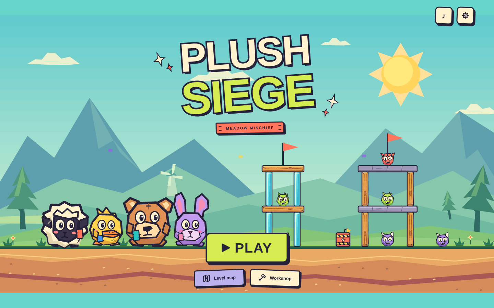
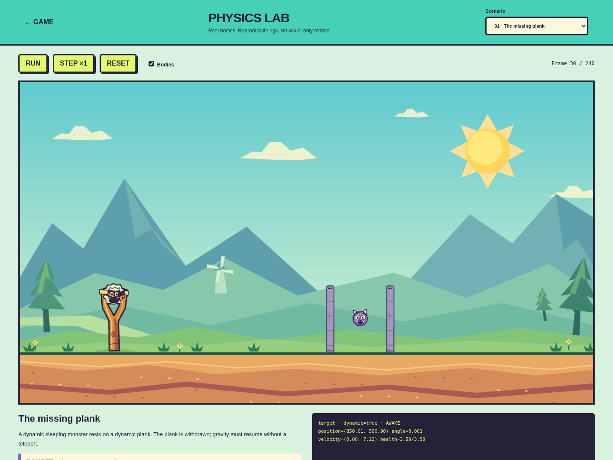

# Development Pass 3 — Monster physics and graphic cartoon overhaul

Version **0.3.0** fixes unsupported sleeping monsters, restores reliable indirect damage, and applies a coherent bold cartoon style to the game and its tools. The campaign remains the same 24 introductory levels. No campaign geometry, ammunition, par counts or score thresholds were changed.

## Actual causes and fixes

The floating defect was reproduced independently of the renderer: a dynamic monster rested on a plank, entered Matter's sleeping state, and stayed at exactly the same height after the plank was removed. `Composite.remove()` does not automatically wake bodies that depended on that support. Sleeping bodies skip gravity integration. Changing their visual position or teleporting them to terrain would have concealed the defect.

The engine now records actual contact dependencies. Support removal, fracture, movement, tilting and contact loss wake the affected body/contact island, including stacked supports and targets. Stable resting bodies continue to sleep. A wake-activity latch also prevents a false last-shot failure during the first falling tick, whose gravity velocity is below the ordinary motion threshold.

Damage was not intentionally restricted to direct stuffie hits. A second defect made indirect attacks unreliable: a retained sleeping collision can reactivate without a fresh `collisionStart` event. The previous callback missed that impact. Existing contact geometry is now sampled before solver resolution as well as on new contacts. One bounded, source-labeled damage pipeline handles projectile, wood/glass/stone, secondary monster, fall, blast and qualified crush damage.

Landing energy distinguishes a substantial fall from a gentle drop. Regression checks preserve full health for 8- and 15-pixel drops onto terrain and static/dynamic planks. Crushing requires a new descending heavy load and physical compression against a support, rather than damage merely because something is touching a monster. Resting heavy loads and low-energy nudges remain harmless. Wood, glass and stone remain dangerous when their actual collision energy is sufficient; cushioned falls can legitimately be survived.

## Visible game and tools

Meadow Mischief now uses angular peaks, faceted trees, graphic sky shapes, vivid color blocks and strong separation between decorative scenery and outlined interactive bodies. All four original stuffies retain their identities, plush patches and seams, with bolder silhouettes and snappier impact expressions. Monsters have asymmetric angular silhouettes, horns, teeth and distinct colors, with danger, falling, injury and defeat reactions. Living monster painting uses the exact rigid-body center and rotation.

Wood, glass, stone, fracture pieces, TNT and the slingshot share the same ink and shape language. The title, campaign map, HUD, queue, dialogs, workshop and installable app icons match the overhaul. The art is original procedural vector geometry, with a reusable painter/palette pipeline; no artwork or character designs from the inspiration shows are used. Rare cosmetic evil flashes remain brief and configurable.

`physics-lab.html` is an inspectable second entry, using the actual game scene and simulator. It provides eleven rigs: plank withdrawal, falling stone, sideways wood, monster fall, push off a ledge, multi-block chain, blast/knockback, shelter collapse, harmless nudge, ordinary stable rest and a newly descending crushing load. Run/Step/Reset, collider outlines, live health/sleep/position/rotation and source-labeled damage make the behavior visible. Explicit rig actions remove supports or apply initial block impulses; they never teleport monsters or inject defeat.

## Reference rules and scope

[GAMEPLAY_RULES.md](../GAMEPLAY_RULES.md) separates established player-visible reference behavior from Plush Siege's original choices and tuning constants. Fresh attempts to access the three external reference pages returned HTTP 403. There was no new frame-by-frame reference capture or extraction of proprietary constants; the document states that limitation rather than presenting unverified numeric fidelity as research evidence.

Only solution witnesses were refreshed where corrected physical interactions changed the old shots. All 24 levels still have independently replayed three-star clears within their existing par counts. No broad campaign balancing, new projectile types, new levels or new worlds were introduced. More sophisticated structures and campaign production remain a future milestone.

## Compatibility

The existing `plush-siege-v1` save key, version, world/level IDs, best scores/stars and settings remain unchanged. **No save migration is required.** Old scores are retained; raw scores from different physics revisions are not strictly comparable. The PWA cache is content-versioned, includes the lab, and updates after an online visit/reopen. Root-origin hosting remains the deployment assumption.

## Verification

The production build/type check passed. **61 automated tests and 174 actual browser checks passed with zero failures**:

| Suite | Passed | Scope |
| --- | ---: | --- |
| Unit/content/physics/save | 61 | Includes all 26 new monster regressions, original destruction/ability tests, stable initial geometry, saved progress, and all campaign shot witnesses |
| Integrated game loop | 19 | Real mouse shot and iPad-size touch shot through victory; restart, next level, map pages, settings, saved progress and workshop loop |
| Rendered destruction/input | 36 | Rotating intact materials, physical fracture pieces, falling roof, four actual pointer abilities and gesture guards |
| Workshop | 18 | Placement, dragging, materials, undo/redo, validation, drafts and JSON I/O |
| Responsive production UI | 40 | Unfiltered production assets at 1440×900, 1180×820, 844×390 and 390×844; navigation, HUD/queue, labels, settings and workshop |
| Rendered monster scenarios | 43 | All eleven rigs; dynamic body checks, actual outcomes, gravity before landing damage, harmless contacts and painter/body synchronization |
| Offline production | 18 | Game/manifest/icons, real three-star shot, restart, saved progress, all eleven lab definitions and lab stepping without network |

The campaign audit independently replayed **24 three-star wins within existing par**, with no invalid/unstable levels or replay failures. Initial stability is measured against authored positions; solution metrics include actual body counts and step costs on this cloud CPU, not a device FPS guarantee. Refreshing nine recorded shot witnesses was sufficient; campaign content and thresholds were not changed.

Evidence: [summary](verification/pass-3-summary.json), [campaign audit and shot sequences](verification/campaign-pass-3.json), [monster browser observations](verification/monsters-pass-3.json), [production layout results](verification/presentation-pass-3.json), and [rendered destruction observations](verification/destruction-pass-3.json).

Reproduce with `npm run build`, `npm test`, and `npm run validate`; use the dev server for `test:browser`, `test:editor`, `test:destruction`, and `test:monsters`. With `npm run preview` serving port 4173, run `test:presentation` and `test:offline`. `GAME_URL` can select a different server.

## Remaining limits and next steps

- Physical iPad Safari, real device frame rate, audio latency and home-screen installation have not been tested. Chromium touch/layout checks are not device certification.
- The reference rules are an honest behavioral specification; external reference access and fresh timing comparison remain incomplete.
- The introductory layouts remain basic. Human feel/difficulty review and richer content design are deferred, as requested.
- Monster colliders are circular with cosmetic angular ears/horns; large fracture pieces use approximate rectangular colliders and bounded two-generation splitting. This is arcade physics, not arbitrary mesh fracture.
- A contact graph and newly moving-load tests govern crushing; it is not a general stress/pressure simulator for every conceivable contraption.

Recommended next pass: play the support-loss, heavy-roof, gentle-fall and crush rigs on an actual iPad, compare several real campaign shots by feel, and tune from that evidence before expanding the campaign. Art-direction review can focus on small character readability, impact timing and background contrast with this coherent visual foundation.

## Visual evidence

Further views: [campaign map](screenshots/pass3-map.png), [gameplay HUD](screenshots/pass3-gameplay.png), [physical fragments](screenshots/pass3-physical-fragments.png), and [original vector asset sheet](screenshots/pass3-asset-sheet.png).
